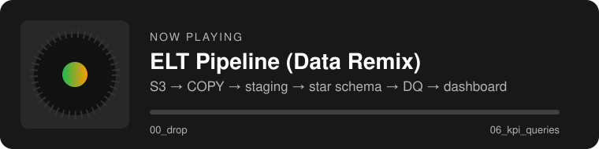
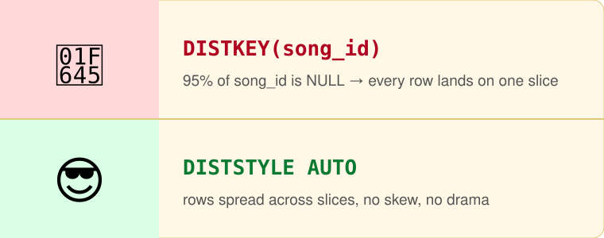

<p align="center">
  
</p>

<p align="center">
  
  
  
  
  
  
</p>

<p align="center">
  <b>Cloud Technology Infrastructure — Data Engineering</b> · group project (5 members) · AWS Academy Learner Lab (us-east-1, $50 budget)
</p>

> 🎶 Sections marked _TODO_ are filled in step by step following [`guidance/GUIDELINE_README.md`](guidance/GUIDELINE_README.md).
> The original Sparkify reference is kept unchanged in [`guidance/README.md`](guidance/README.md).

---

## 🎧 1. Project Overview

Sparkify, a music streaming startup, collects user activity logs and song metadata as JSON files but cannot
answer business questions from them. This project builds a **cloud data warehouse on AWS** (S3 → Redshift → Metabase)
inside a secured VPC to turn the raw logs into analytics.

<p align="center"></p>

## 🎯 2. Business Questions

| # | Question | Business use |
|---|---|---|
| BQ1 | Which hours and days of the week have the highest listening traffic? | Capacity planning / scaling |
| BQ2 | How does engagement (songs per session) differ between free and paid users? | Value of the subscription |
| BQ3 | Upgrade funnel — what % of users who open the Upgrade page actually submit, and how active are they? | Target free users for promotions |
| BQ4 | Churn risk — which paid users visit the Downgrade page, and does their activity drop beforehand? | Retention early-warning list |
| BQ5 | Which states have the highest ratio of paid users? | Regional marketing |

> BQ3 and BQ4 need non-`NextSong` events, so the model adds a second fact table `fact_page_events`.

## 💿 3. Dataset & Profiling

| Source | Files | Content |
|---|---|---|
| `song_data` | 14,896 JSON | Song + artist metadata (subset of the Million Song Dataset) |
| `log_data` | 30 JSON | App events, Nov 2018 — 8,056 events, 97 users, 941 sessions |
| `log_json_path.json` | 1 | JSONPath mapping for Redshift `COPY` |

Download locally: `python3 scripts/download_dataset.py` → `data/raw/`
Profiling notebook: [`notebooks/01_data_profiling.ipynb`](notebooks/01_data_profiling.ipynb)

<p align="center"></p>

**Early answers from the raw data** (to be confirmed on Redshift):

<p align="center"></p>
<p align="center"></p>

| 🔎 Finding | 🛠️ Design impact |
|---|---|
| Song match rate ≈ **4.7%** (319 / 6,820 plays) | No `DISTKEY(song_id)` on the fact table; match rate reported as a DQ metric |
| 396 `artist_id`s have >1 `artist_name` | Deduplicate `dim_artists` + duplicate-key DQ check |
| 286 events with empty `userId` (logged-out pages only) | Filter before loading user tables |
| 8 users switch free ↔ paid during the month | `dim_users` as **SCD Type 2** |
| Paid sessions: **28.4** songs vs free: **2.1** | Strong signal for BQ2 |

## ☁️ 4. Architecture

<p align="center"></p>

Full design (network, security groups, IAM, monitoring, Learner Lab constraints): [`docs/architecture.md`](docs/architecture.md) ·
editable diagrams: [`docs/architecture.drawio`](docs/architecture.drawio)

| Layer | Choice |
|---|---|
| Environment | **AWS Academy Learner Lab** — constraints in [`docs/architecture.md` §0](docs/architecture.md) |
| Region | `us-east-1` |
| Network | VPC `10.0.0.0/16`, 2 AZs, 2 public + 2 private subnets, Internet Gateway, S3 gateway endpoint, **no NAT** |
| Raw storage | S3 `sparkify-raw-<group>` (Block Public Access, SSE-S3, Versioning) |
| Data warehouse | Redshift provisioned, 1 × `ra3.large`, **private subnets**, not publicly accessible, Enhanced VPC Routing |
| ETL + dashboard | EC2 `t3.small` in a public subnet: Python ETL + Metabase (Docker) |
| Access | **Session Manager** (no SSH key, port 22 closed) |
| Security groups | `sparkify-sg-app`: 3000 from team IPs only · `sparkify-sg-redshift`: 5439 from `sparkify-sg-app` only |
| IAM | Pre-created `LabRole` (Redshift → S3) and `LabInstanceProfile` (EC2 → SSM). Learner Lab cannot create custom roles |
| Monitoring | CloudWatch alarms (CPU, disk, health) → SNS email |

<details>
<summary>🔀 <b>Data flow</b> (click to expand)</summary>
<br>
<p align="center"></p>
</details>

## 🗂️ 5. Data Model

<p align="center"></p>

Full design, data dictionary and rationale: [`docs/data_model.md`](docs/data_model.md) · ERD sources: [`docs/erd.drawio`](docs/erd.drawio) / [`docs/erd.mmd`](docs/erd.mmd)

| Table | Type | Grain | DISTSTYLE | SORTKEY |
|---|---|---|---|---|
| `fact_songplays` | Fact | one song play | `AUTO` | `start_time` |
| `fact_page_events` | Fact | one page event (logged-in) | `AUTO` | `start_time` |
| `dim_users` | Dimension, **SCD Type 2** | one user version (level period) | `ALL` | `user_id` |
| `dim_songs` | Dimension | one song | `ALL` | `song_id` |
| `dim_artists` | Dimension | one artist (deduplicated) | `ALL` | `artist_id` |
| `dim_time` | Dimension | one timestamp | `ALL` | `start_time` |

Why not the classic `DISTKEY(song_id)`? A picture is worth a thousand slices:

<p align="center"></p>

## 🔄 6. ETL Pipeline

An **ELT** pipeline: raw JSON is loaded into Redshift as-is (staging), then transformed with SQL inside the warehouse.

```text
00_drop → 01_create_staging → 02_create_star_schema → 03_copy_from_s3 → 04_transform_load → 05_data_quality → 06_kpi_queries
```

| Step | File | What it does |
|---|---|---|
| 1 | `sql/00`–`02` | Drop and recreate staging and star-schema tables (`scripts/create_tables.py`) |
| 2 | `sql/03_copy_from_s3.sql` | `COPY` raw JSON from our S3 bucket into `staging_events` (JSONPath file) and `staging_songs` (`'auto'`) |
| 3 | `sql/04_transform_load.sql` | Transform into the star schema (below) |
| 4 | `sql/05_data_quality.sql` | Run the checks in §7. `scripts/etl.py` exits with an error if any check fails |
| 5 | `sql/06_kpi_queries.sql` | Answer BQ1–BQ5 and feed the dashboard (run by hand / Metabase) |

Transform rules in `04_transform_load.sql` (details: [`docs/data_model.md` §5](docs/data_model.md)):

- `ts` (epoch milliseconds) → `TIMESTAMP`; logged-out events (`userId = ''`) are excluded
- `dim_artists`: one row per `artist_id`, shortest name wins · `dim_songs`: `year = 0` → `NULL`
- `dim_users` **SCD Type 2**: a new version starts whenever a user's `level` changes
- Facts look up `user_key` by the version valid at the event time
- `fact_songplays` matches songs on title + artist + duration; `song_id` / `artist_id` stay `NULL` when not in the catalog

`create_tables.py` and `etl.py` rebuild everything, so they can be run again safely. Each SQL file runs in one transaction (all or nothing).

## ✅ 7. Data Quality

`sql/05_data_quality.sql` returns one row per check (`PASS` / `FAIL` / `INFO`). Expected values are computed from the staging tables, so no number is hard-coded. Redshift does not enforce primary or foreign keys, so these checks do that job.

| Group | Checks |
|---|---|
| Staging | Both staging tables are not empty |
| Row counts | `fact_songplays` = logged-in `NextSong` events · `fact_page_events` = logged-in events |
| `dim_users` (SCD2) | Every logged-in user present · exactly one current version per user · no version with `valid_from >= valid_to` |
| NULLs | No NULL `user_id` / `user_key` / `start_time` in either fact |
| Duplicate keys | None in `dim_artists`, `dim_songs`, `dim_time`, `dim_users` |
| Orphan keys | No fact row without its `dim_time` / `dim_users` row · no `song_id` / `artist_id` missing from dimensions |
| Reported (`INFO`) | Song match rate · logged-out events excluded · `dim_users` versions |

**Values expected from profiling** (matched exactly when the full pipeline was run on a local DuckDB copy of the raw data):

| Check | Expected |
|---|---|
| `staging_events` / `staging_songs` rows | 8,056 / 14,896 |
| `fact_songplays` rows (NextSong only) | 6,820 |
| `fact_page_events` rows (logged-in) | 7,770 |
| `dim_users` versions / current users | 106 / 97 |
| `dim_artists` rows (no duplicate keys) | 9,553 |
| NULL `user_id` / `start_time` in facts | 0 |
| Song match rate | ≈ 4.7% (319 / 6,820) |

> The DuckDB run only tests the SQL logic. Results from the real Redshift cluster will be added after the AWS build.
> Some artist names look garbled (e.g. `Björk`). They are already double-encoded in the source files, not a pipeline bug.

## 📊 8. KPI Results & Dashboard

_TODO (Step 6.7)._ Metabase dashboard screenshots will go in `screenshots/dashboard/`.

## 🏛️ 9. Well-Architected Pillars

Full review with proof checklist and failure scenarios: [`docs/well_architected.md`](docs/well_architected.md)

| Pillar | As-built (Learner Lab) | Ideal (production) |
|---|---|---|
| 🔒 **Security** | Redshift in private subnets, not public · SG chain (EC2 → Redshift 5439 only) · Metabase for team IPs only · no SSH (Session Manager) · S3 Block Public Access + SSE-S3 · Redshift encrypted · IAM role instead of keys · secrets gitignored | Least-privilege roles, Secrets Manager rotation, KMS CMK, HTTPS + WAF, CloudTrail, GuardDuty |
| 🟢 **Availability** | 2 AZs, Redshift subnet group in 2 AZs, S3 multi-AZ, Metabase auto-restart, health alarm | Redshift Multi-AZ, Metabase on ECS Fargate behind ALB |
| ♻️ **Resiliency** | Raw data in S3 (Versioning) → DW rebuildable · automated snapshots · idempotent ETL · data-quality gate · CloudWatch → SNS email | Cross-region snapshot copy, S3 CRR, Step Functions retries |
| 💰 **Cost** | 1 × `ra3.large`, pause when idle, `t3.small`, no NAT, free S3 endpoint, Metabase, one region, delete after demo | Reserved nodes / Serverless, S3 lifecycle → Glacier, AWS Budgets |

<details>
<summary>🚀 <b>Ideal production architecture</b> (cost not considered — click to expand)</summary>
<br>
<p align="center"></p>
</details>

## 💸 10. Cost Estimate

Details and the $50 Learner Lab budget plan: [`docs/cost_estimate.md`](docs/cost_estimate.md) ·
AWS Pricing Calculator exports: [scenario A](docs/cost-estimate-scenario-a.pdf) · [scenario B](docs/cost-estimate-scenario-b.pdf)

| Scenario | Redshift hours | Monthly cost |
|---|---|---|
| 🎵 A — Learner Lab project (pause when idle) | 40 | ≈ **$25** (calculator $23.93 + public IPv4/EBS) |
| 🔁 B — Same architecture 24/7 | 730 | **$416.34** ($4,996 / year) |

> ⏸️ `ra3.large` costs **$0.543/hour**, so Redshift is over 90% of the bill. **Pause it after every session** —
> the Learner Lab does not do it for you. Checklists and teardown order: [`docs/cleanup.md`](docs/cleanup.md)

## ▶️ 11. How to Run

**1. Local (laptop): get the data and profile it**

```bash
python3 -m venv .venv && .venv/bin/pip install -r requirements.txt
```

```bash
.venv/bin/python scripts/download_dataset.py
```

**2. AWS (Learner Lab):** build the infrastructure first ([`docs/architecture.md`](docs/architecture.md)), then:

1. Copy `config/dwh.cfg.example` to `config/dwh.cfg` and fill in the Redshift endpoint, user, password, the `LabRole` ARN and the bucket name (the file is gitignored)
2. Upload the raw data to S3 (in CloudShell, run `download_dataset.py` first because it has no local files):

```bash
scripts/upload_to_s3.sh sparkify-raw-<group>
```

3. On the EC2 instance (Session Manager), after `git clone` and `pip install psycopg2-binary boto3`:

```bash
python3 scripts/create_tables.py
```

```bash
python3 scripts/etl.py
```

`etl.py` prints the data-quality result and exits with an error if a check fails. If `COPY` fails, it prints the latest rows of `sys_load_error_detail`.

4. Run the queries in `sql/06_kpi_queries.sql` in Redshift Query Editor v2 or Metabase.

> ⏸️ **Pause the Redshift cluster at the end of every session.** See [`docs/cleanup.md`](docs/cleanup.md).

## 📁 12. Repository Structure

```text
├── README.md                # this file
├── guidance/                # original Sparkify README, step-by-step guide, progress checkpoint
├── config/dwh.cfg.example   # config template (copy to config/dwh.cfg, never commit)
├── data/raw/                # downloaded dataset (gitignored)
├── docs/                    # design docs, diagrams, cost estimate PDFs
│   ├── assets/              # README banner and animated graphics
│   └── figures/             # exported diagrams and profiling charts
├── notebooks/               # local data profiling (Jupyter)
├── report/                  # Word report (Thai) + generator source
├── requirements.txt         # Python packages for notebooks
├── screenshots/             # evidence per AWS service (kept local, not committed: contains account IDs / e-mails)
├── scripts/                 # download / upload / create_tables / etl (+ dwh_utils.py shared helpers)
└── sql/                     # 00–06 SQL files
```

## 👥 13. Team Roles

| Role | Responsibility | Member |
|---|---|---|
| Infra / Network | VPC, Security Groups, Redshift, EC2, architecture diagram | _TBD_ |
| Data Modeler | ERD, DDL, DIST/SORT key design | _TBD_ |
| ETL | COPY, transform SQL, `etl.py` | _TBD_ |
| Analytics | KPI queries, Metabase dashboard | _TBD_ |
| QA + Docs + PM | DQ checks, screenshots, README, report, cost estimate | _TBD_ |

---

<p align="center"><sub>🎵 Dataset: Sparkify sample from the Udacity Data Engineering program (subset of the Million Song Dataset). Built for learning purposes. 🎵</sub></p>
